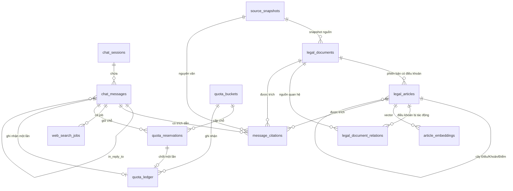

# Data dictionary — Phase 2 core schema

**Ngày lập:** 12/11/2026  
**Phạm vi:** Phase 2 — thiết kế dữ liệu, vòng đời tin nhắn và tính nhất quán quota.  
**Nguồn chuẩn:** `src/main/resources/db/migration/V2__core_schema.sql` (schema) và các service trong package `chat`, `quota`, `websearch`, `legaldata`.  
**Kiểm chứng:** `G2AcceptanceTest` chạy trên PostgreSQL 18 + pgvector thật qua Testcontainers.

Tài liệu này mô tả schema đã triển khai, không phải thiết kế đề xuất. Khi schema và tài liệu khác nhau, migration là nguồn chuẩn.

## 1. Nguyên tắc chung

- Múi giờ nghiệp vụ: `Asia/Ho_Chi_Minh`. `applicable_date` và `quota_period` là ngày lịch `date`; mọi mốc thời gian khác là `timestamptz`.
- Khóa chính dùng `uuid` với `gen_random_uuid()`.
- Foreign key được khai báo tường minh. Dữ liệu con của phiên/tin nhắn dùng `ON DELETE CASCADE`; dữ liệu pháp lý hoặc ledger dùng chặn xóa mặc định để bảo toàn truy vết.
- Enum lưu dạng `varchar` + `CHECK` để DB từ chối giá trị lạ, đồng thời ánh xạ Java enum bằng `EnumType.STRING`.
- `article_embeddings.embedding` là `vector(768)` và **không** ánh xạ qua JPA. Truy cập vector dùng Spring JDBC + `PGobject` kiểu `vector`, đúng quyết định trong `docs/decisions.md`.
- Mọi thao tác đọc/ghi theo ID tin nhắn đều nhận `SessionOwner` và kiểm tra chủ sở hữu phiên. Không tồn tại và không thuộc sở hữu trả cùng lỗi `ChatAccessDeniedException` để tránh dò ID.

## 2. Sơ đồ quan hệ

## 3. Danh mục enum

| Enum Java | Giá trị | Ghi chú |
| --- | --- | --- |
| `Sender` | `USER`, `AI` | `USER` không có `in_reply_to_id`; `AI` bắt buộc có. |
| `MessageStatus` | `PROCESSING_LOCAL`, `AWAITING_WEB_CONFIRM`, `WEB_QUEUED`, `WEB_SEARCHING`, `COMPLETED`, `CANCELLED`, `EXPIRED`, `NO_EVIDENCE`, `WEB_FAILED`, `FAILED`, `NEEDS_CLARIFICATION` | Vòng đời của tin nhắn AI. |
| `MessageOutcome` | `ANSWERED`, `AWAITING_WEB_CONFIRM`, `NEEDS_CLARIFICATION`, `CANCELLED`, `EXPIRED`, `NO_EVIDENCE`, `WEB_FAILED`, `FAILED` | Kết quả nghiệp vụ đi kèm trạng thái; có thể `NULL` khi đang xử lý. |
| `SessionOwnerType` | `ANON`, `USER` | Chủ sở hữu phiên/quota. |
| `EffectiveStatus` | `EFFECTIVE`, `UPCOMING`, `EXPIRED`, `UNKNOWN` | Hiệu lực tại ngày áp dụng. |
| `VerificationStatus` | `QUARANTINED`, `READY`, `ARCHIVED`, `REJECTED` | Chỉ `READY` được dùng để trả lời khẳng định. |
| `LegalHierarchyLevel` | `DIEU`, `KHOAN`, `DIEM` | Cấp cây pháp lý. |
| `LegalRelationType` | `AMENDMENT`, `REPLACEMENT`, `REPEAL` | Quan hệ sửa đổi/thay thế/bãi bỏ. |
| `EmbeddingStatus` | `PENDING`, `READY`, `STALE`, `FAILED` | Chỉ vector `READY` được truy xuất. |
| `WebSearchJobStatus` | `QUEUED`, `CLAIMED`, `RUNNING`, `RETRY_WAIT`, `SUCCEEDED`, `FAILED`, `CANCELLED`, `EXPIRED` | `QUEUED/CLAIMED/RUNNING/RETRY_WAIT` là trạng thái đang hoạt động. |
| `WebSearchJobStage` | `QUEUED`, `CLAIM`, `SEARCH`, `FETCH`, `SNAPSHOT`, `PARSE`, `VALIDATE`, `EMBED`, `PUBLISH`, `RETRIEVE_AGAIN`, `FINALIZE` | Stage chi tiết của pipeline. |
| `QuotaSubjectType` | `ANON`, `USER` | Loại chủ thể của bucket. |
| `QuotaReservationStatus` | `ACTIVE`, `COMMITTED`, `RELEASED`, `EXPIRED` | Chỉ `ACTIVE` đang giữ chỗ. |

## 4. Từ điển bảng

### 4.1. `chat_sessions`

Một phiên hội thoại thuộc đúng một chủ sở hữu: tài khoản hoặc mã khách ẩn danh do server cấp.

| Cột | Kiểu | Null | Mặc định | Ràng buộc |
| --- | --- | --- | --- | --- |
| `id` | `uuid` | không | `gen_random_uuid()` | PK |
| `owner_user_id` | `varchar(100)` | có | — | Một trong hai cột chủ sở hữu phải có giá trị |
| `anon_id` | `varchar(64)` | có | — | UUID v4 của khách ẩn danh |
| `created_at` | `timestamptz` | không | `now()` | — |
| `last_activity_at` | `timestamptz` | không | `now()` | Cập nhật khi gửi câu hỏi |
| `expires_at` | `timestamptz` | không | — | Hết hạn phiên (mặc định 90 ngày) |

Ràng buộc `ck_chat_sessions_owner`: đúng một trong `owner_user_id`/`anon_id` khác `NULL`.  
Index: `idx_chat_sessions_anon_id`, `idx_chat_sessions_owner_user_id`, `idx_chat_sessions_expires_at`.

### 4.2. `source_snapshots`

Bản nguồn bất biến dùng để đối chiếu nguyên văn. Không có cột `updated_at`; ứng dụng không được sửa nội dung snapshot.

| Cột | Kiểu | Null | Ràng buộc |
| --- | --- | --- | --- |
| `id` | `uuid` | không | PK |
| `source_url` | `text` | không | URL nguồn |
| `content` | `text` | có | Nội dung thô, hoặc dùng `storage_path` |
| `storage_path` | `text` | có | Đường dẫn lưu trữ nội dung thô |
| `content_sha256` | `varchar(64)` | không | `^[0-9a-f]{64}$` |
| `fetched_at` | `timestamptz` | không | Thời điểm tải, khác với ngày hiệu lực |
| `content_type` | `varchar(100)` | không | — |
| `parser_version` | `varchar(50)` | không | — |
| `byte_size` | `bigint` | có | `>= 0` |
| `created_at` | `timestamptz` | không | — |

Ràng buộc `ck_source_snapshots_payload`: phải có `content` hoặc `storage_path` (hoặc cả hai).  
Unique `uq_source_snapshots_dedupe (source_url, content_sha256, parser_version)` chống nạp trùng cùng nội dung.  
Index: `idx_source_snapshots_fetched_at`.

### 4.3. `legal_documents`

Mỗi dòng là **một phiên bản nguồn**. `document_key` nhóm các phiên bản của cùng văn bản; câu hỏi lịch sử có thể chọn phiên bản đúng ngày áp dụng.

| Cột | Kiểu | Null | Ràng buộc |
| --- | --- | --- | --- |
| `id` | `uuid` | không | PK |
| `document_key` | `varchar(160)` | không | Khóa nhóm phiên bản |
| `title` | `text` | không | Tiêu đề văn bản |
| `doc_number` | `varchar(100)` | có | Số hiệu, bắt buộc khi `READY` |
| `issuing_body` | `varchar(255)` | có | Cơ quan ban hành, bắt buộc khi `READY` |
| `issue_date` | `date` | có | Ngày ban hành, bắt buộc khi `READY` |
| `effective_from` | `date` | có | Bắt buộc khi `READY` |
| `effective_to` | `date` | có | Không nhỏ hơn `effective_from` |
| `effective_status` | `varchar(32)` | không | `EFFECTIVE/UPCOMING/EXPIRED/UNKNOWN`, mặc định `UNKNOWN` |
| `source_url` | `text` | không | — |
| `snapshot_id` | `uuid` | không | FK → `source_snapshots(id)` |
| `verification_status` | `varchar(32)` | không | `QUARANTINED` mặc định; `READY/ARCHIVED/REJECTED` |
| `published_at` | `timestamptz` | có | — |
| `last_verified_at` | `timestamptz` | có | Dùng cho quy tắc độ mới 30 ngày |
| `created_at`, `updated_at` | `timestamptz` | không | — |

Ràng buộc `ck_legal_documents_ready_metadata`: chuyển `READY` chỉ khi số hiệu, cơ quan, ngày ban hành, hiệu lực và ngày hiệu lực đã xác minh; `effective_status` không được `UNKNOWN`.  
Unique `uq_legal_documents_version (document_key, snapshot_id)`.  
Index: `document_key`, `doc_number`, `verification_status`, `(effective_from, effective_to)`, `snapshot_id`.

### 4.4. `legal_articles`

Cây Điều/Khoản/Điểm. `raw_text` là nguyên văn dùng để hiển thị/trích dẫn; `search_text` chỉ phục vụ tìm kiếm.

| Cột | Kiểu | Null | Ràng buộc |
| --- | --- | --- | --- |
| `id` | `uuid` | không | PK |
| `document_id` | `uuid` | không | FK → `legal_documents(id)` `ON DELETE CASCADE` |
| `parent_id` | `uuid` | có | FK tự thân; không trỏ chính nó |
| `hierarchy_level` | `varchar(16)` | không | `DIEU/KHOAN/DIEM` |
| `article_code` | `varchar(64)` | không | Unique trong một văn bản |
| `article_number` | `varchar(32)` | không | Số/định danh hiển thị |
| `title` | `text` | có | — |
| `raw_text` | `text` | không | Nguyên văn |
| `search_text` | `text` | không | Bản chuẩn hóa cho FTS |
| `search_vector` | `tsvector` | sinh tự động | `to_tsvector('simple', title + search_text)` |
| `locator` | `varchar(255)` | không | Ví dụ “Điều 10 khoản 3 điểm a” |
| `scope` | `varchar(255)` | có | Phạm vi áp dụng nếu biết |
| `effective_from`, `effective_to` | `date` | có | Hiệu lực cấp điều khoản; thứ tự hợp lệ |
| `verification_status` | `varchar(32)` | không | `QUARANTINED` mặc định |
| `created_at`, `updated_at` | `timestamptz` | không | — |

Unique `uq_legal_articles_code (document_id, article_code)`.  
Index: document, parent, verification, effective range và **GIN** `idx_legal_articles_search_vector` cho FTS.

### 4.5. `legal_document_relations`

Quan hệ có kiểm chứng giữa các phiên bản văn bản/điều khoản.

| Cột | Kiểu | Null | Ràng buộc |
| --- | --- | --- | --- |
| `id` | `uuid` | không | PK |
| `source_document_id`, `target_document_id` | `uuid` | không | FK → `legal_documents`, khác nhau |
| `source_article_id`, `target_article_id` | `uuid` | có | FK → `legal_articles` |
| `relation_type` | `varchar(32)` | không | `AMENDMENT/REPLACEMENT/REPEAL` |
| `verification_status` | `varchar(32)` | không | `QUARANTINED` mặc định |
| `notes` | `text` | có | — |
| `created_at` | `timestamptz` | không | — |

Unique biểu thức `uq_legal_document_relations_identity` chống tạo trùng cùng cặp nguồn/đích/loại/điều khoản (dùng `coalesce` cho cột điều khoản `NULL`).  
Index: target document, source article, target article.

### 4.6. `article_embeddings`

Vector của điều khoản/chunk. Mỗi vector gắn chặt với model, không gian và hash văn bản.

| Cột | Kiểu | Null | Ràng buộc |
| --- | --- | --- | --- |
| `id` | `uuid` | không | PK |
| `article_id` | `uuid` | không | FK → `legal_articles` `ON DELETE CASCADE` |
| `chunk_index` | `integer` | không | `>= 0`, mặc định `0` |
| `model_id` | `varchar(100)` | không | `CHECK = 'gemini-embedding-001'` |
| `embedding_space_id` | `varchar(100)` | không | Không rỗng; mặc định nghiệp vụ `gemini-embedding-001@768:v1` |
| `dimensions` | `integer` | không | `CHECK = 768` |
| `text_hash` | `varchar(64)` | không | `^[0-9a-f]{64}$` |
| `embedding` | `vector(768)` | không | Vector thô, cosine distance |
| `status` | `varchar(16)` | không | `PENDING/READY/STALE/FAILED` |
| `created_at`, `updated_at` | `timestamptz` | không | — |

Unique `uq_article_embeddings_identity (article_id, model_id, embedding_space_id, chunk_index, text_hash)` chống gọi lại embedding cho nội dung không đổi.  
Index **HNSW** `idx_article_embeddings_embedding_hnsw USING hnsw (embedding vector_cosine_ops)`.  
Index `status`, `(embedding_space_id, status)`.

### 4.7. `chat_messages`

Tin nhắn USER và AI. Tin nhắn AI sở hữu state machine; tin nhắn USER được ghi với `message_status = COMPLETED` khi đã lưu câu hỏi.

| Cột | Kiểu | Null | Ràng buộc |
| --- | --- | --- | --- |
| `id` | `uuid` | không | PK |
| `session_id` | `uuid` | không | FK → `chat_sessions` `ON DELETE CASCADE` |
| `sender` | `varchar(16)` | không | `USER/AI` |
| `in_reply_to_id` | `uuid` | có | FK tự thân; USER phải `NULL`, AI phải có |
| `idempotency_key` | `varchar(128)` | có | Chỉ USER; duy nhất theo phiên |
| `content` | `text` | không | Mặc định `''`; AI `COMPLETED` phải không rỗng |
| `message_status` | `varchar(32)` | không | Một trong 11 trạng thái |
| `outcome` | `varchar(32)` | có | Một trong 8 kết quả nghiệp vụ |
| `suggested_query` | `text` | có | Query Web đã lưu ở server, không nhận từ trình duyệt |
| `applicable_date` | `date` | không | Ngày áp dụng theo `Asia/Ho_Chi_Minh` |
| `question_hash` | `varchar(64)` | có | SHA-256 câu hỏi đã chuẩn hóa |
| `confirm_expires_at` | `timestamptz` | có | Hạn consent 15 phút |
| `confirmed_at` | `timestamptz` | có | Không muộn hơn `confirm_expires_at` |
| `version` | `bigint` | không | Optimistic locking, mặc định `0` |
| `created_at`, `updated_at` | `timestamptz` | không | — |

Unique `uq_chat_messages_idempotency (session_id, idempotency_key)`: khóa chống gửi lặp.  
Check: `sender='AI'` phải có `in_reply_to_id`; `sender='USER'` phải không có; `question_hash` đúng định dạng; `confirmed_at <= confirm_expires_at`; AI `COMPLETED` phải có nội dung.  
Index: `(session_id, created_at)`, `message_status`, `in_reply_to_id`, partial index `(confirm_expires_at) WHERE message_status='AWAITING_WEB_CONFIRM'`.

### 4.8. `message_citations`

Trích dẫn hiển thị cho người đọc. Nguyên văn là bản sao từ snapshot nguồn; các cột ID cho phép mở đúng văn bản/điều khoản.

| Cột | Kiểu | Null | Ràng buộc |
| --- | --- | --- | --- |
| `id` | `uuid` | không | PK |
| `message_id` | `uuid` | không | FK → `chat_messages` `ON DELETE CASCADE` |
| `document_version_id` | `uuid` | không | FK → `legal_documents` |
| `article_id` | `uuid` | không | FK → `legal_articles` |
| `source_snapshot_id` | `uuid` | không | FK → `source_snapshots` |
| `citation_order` | `integer` | không | `>= 0`, unique trong tin nhắn |
| `excerpt_start`, `excerpt_end` | `integer` | không | `start >= 0`, `end > start` |
| `locator` | `varchar(255)` | không | Điều/Khoản/Điểm |
| `verbatim_text` | `text` | không | Không rỗng |
| `created_at` | `timestamptz` | không | — |

Unique `uq_message_citations_order (message_id, citation_order)`.  
Index: message, article, document.

### 4.9. `web_search_jobs`

Job bền vững, có lease/heartbeat. Tối đa **một job đang hoạt động** cho mỗi tin nhắn.

| Cột | Kiểu | Null | Ràng buộc |
| --- | --- | --- | --- |
| `id` | `uuid` | không | PK |
| `message_id` | `uuid` | không | FK → `chat_messages` `ON DELETE CASCADE` |
| `job_status` | `varchar(32)` | không | 8 trạng thái, mặc định `QUEUED` |
| `attempt_count` | `integer` | không | `0..2` (giới hạn 2 lần thử) |
| `stage` | `varchar(32)` | không | 11 stage, mặc định `QUEUED` |
| `lease_token` | `uuid` | có | Cùng hiện diện với owner/expiry |
| `lease_owner` | `varchar(100)` | có | — |
| `lease_expires_at` | `timestamptz` | có | Lease 60 giây theo quyết định |
| `heartbeat_at` | `timestamptz` | có | Chỉ khi có lease |
| `deadline` | `timestamptz` | không | Hạn toàn job (120 giây khi tạo) |
| `error_code` | `varchar(64)` | có | — |
| `created_at`, `updated_at` | `timestamptz` | không | — |

Unique **partial** `uq_web_search_jobs_active_per_message (message_id) WHERE job_status IN ('QUEUED','CLAIMED','RUNNING','RETRY_WAIT')` — bấm đồng ý lặp không thể tạo job thứ hai.  
Index: `(job_status, lease_expires_at)`, `deadline`.

### 4.10. `quota_buckets`

Bộ đếm quota theo chủ thể và ngày Việt Nam.

| Cột | Kiểu | Null | Ràng buộc |
| --- | --- | --- | --- |
| `id` | `uuid` | không | PK |
| `subject_type` | `varchar(16)` | không | `ANON/USER` |
| `anon_id` | `varchar(64)` | có | Bắt buộc với `ANON` |
| `owner_user_id` | `varchar(100)` | có | Bắt buộc với `USER` |
| `quota_period` | `date` | không | `yyyy-MM-dd` theo `Asia/Ho_Chi_Minh` |
| `limit_count` | `integer` | không | Mặc định **5**, `>= 0` |
| `used_count` | `integer` | không | `>= 0` |
| `reserved_count` | `integer` | không | `>= 0` |
| `created_at`, `updated_at` | `timestamptz` | không | — |

Check `ck_quota_buckets_subject`: đúng một loại chủ thể và đúng cột tương ứng.  
Check `ck_quota_buckets_capacity`: `used_count + reserved_count <= limit_count`.  
Unique partial theo kỳ: `(quota_period, anon_id)` và `(quota_period, owner_user_id)`.

### 4.11. `quota_reservations`

Giữ chỗ cho một tin nhắn/lần xử lý.

| Cột | Kiểu | Null | Ràng buộc |
| --- | --- | --- | --- |
| `id` | `uuid` | không | PK |
| `bucket_id` | `uuid` | không | FK → `quota_buckets` `ON DELETE CASCADE` |
| `message_id` | `uuid` | không | FK → `chat_messages` `ON DELETE CASCADE` |
| `status` | `varchar(16)` | không | `ACTIVE/COMMITTED/RELEASED/EXPIRED` |
| `idempotency_key` | `varchar(128)` | không | 1..128 ký tự |
| `expires_at` | `timestamptz` | không | Mặc định 15 phút |
| `committed_at` | `timestamptz` | có | Bắt buộc khi `COMMITTED` |
| `released_at` | `timestamptz` | có | Bắt buộc khi `RELEASED` |
| `created_at`, `updated_at` | `timestamptz` | không | — |

Unique `uq_quota_reservations_idempotency (message_id, idempotency_key)`.  
Unique **partial** `uq_quota_reservations_active_per_message (message_id) WHERE status='ACTIVE'`: mỗi tin nhắn chỉ có tối đa một giữ chỗ đang hoạt động.  
Index: `(bucket_id, status)`, `(status, expires_at)`.

### 4.12. `quota_ledger`

Lịch sử sử dụng **append-only**. Mỗi câu trả lời chỉ tiêu đúng một lượt.

| Cột | Kiểu | Null | Ràng buộc |
| --- | --- | --- | --- |
| `id` | `uuid` | không | PK |
| `bucket_id` | `uuid` | không | FK → `quota_buckets` |
| `reservation_id` | `uuid` | không | FK → `quota_reservations`, unique |
| `answer_message_id` | `uuid` | không | FK → `chat_messages`, **unique** |
| `quantity` | `integer` | không | Mặc định `1`, `> 0` |
| `quota_period` | `date` | không | Kỳ bị trừ |
| `created_at` | `timestamptz` | không | — |

Unique `uq_quota_ledger_answer_message`: DB bảo đảm một `answer_message_id` không thể ghi hai lần.  
Unique `uq_quota_ledger_reservation`: một reservation không thể chốt hai lần.  
Trigger `trg_quota_ledger_immutable` từ chối mọi `UPDATE`/`DELETE` trên bảng.

## 5. State machine của tin nhắn AI

### 5.1. Bảng chuyển trạng thái hợp lệ

| Từ | Sang | Tác nhân | Tác dụng quota/job |
| --- | --- | --- | --- |
| `PROCESSING_LOCAL` | `COMPLETED` | Answer service | Commit reservation + ghi ledger một lần |
| `PROCESSING_LOCAL` | `AWAITING_WEB_CONFIRM` | Local retrieval | Giải phóng reservation; đặt `confirm_expires_at = now + 15 phút`; lưu `suggested_query` |
| `PROCESSING_LOCAL` | `NEEDS_CLARIFICATION` | Local retrieval | Giải phóng reservation |
| `PROCESSING_LOCAL` | `FAILED` | Local retrieval | Giải phóng reservation |
| `AWAITING_WEB_CONFIRM` | `WEB_QUEUED` | Người dùng xác nhận | Kiểm tra consent + question hash; reserve slot mới; tạo đúng một job `QUEUED` |
| `AWAITING_WEB_CONFIRM` | `CANCELLED` | Người dùng từ chối | Giải phóng nếu còn reservation; không job |
| `AWAITING_WEB_CONFIRM` | `EXPIRED` | Hết hạn consent | Giải phóng nếu còn reservation; không job |
| `WEB_QUEUED` | `WEB_SEARCHING` | Worker claim | Không đổi quota |
| `WEB_QUEUED` | `WEB_FAILED` | Worker/ops | Giải phóng reservation |
| `WEB_QUEUED` | `FAILED` | Worker/ops | Giải phóng reservation |
| `WEB_SEARCHING` | `COMPLETED` | Answer service | Commit reservation + ledger một lần |
| `WEB_SEARCHING` | `NO_EVIDENCE` | Worker | Giải phóng reservation; không tự mở job mới |
| `WEB_SEARCHING` | `WEB_FAILED` | Worker | Giải phóng reservation |
| `WEB_SEARCHING` | `FAILED` | Worker | Giải phóng reservation |
| `WEB_FAILED` | `WEB_QUEUED` | Người dùng retry có kiểm tra consent | Reservation mới + job mới |

Các trạng thái kết thúc với một tin nhắn: `COMPLETED`, `CANCELLED`, `EXPIRED`, `NO_EVIDENCE`, `FAILED`, `NEEDS_CLARIFICATION`. `WEB_FAILED` không phải kết thúc vì còn một lần retry thủ công.

### 5.2. Quy tắc bắt buộc

1. Chỉ `WEB_QUEUED` mới được tạo job; message chuyển sang `WEB_QUEUED` trong cùng transaction với reserve quota và insert job.
2. `AWAITING_WEB_CONFIRM` chỉ hợp lệ khi có `suggested_query`, `question_hash` và `confirm_expires_at`.
3. Xác nhận chỉ hợp lệ khi `now <= confirm_expires_at` và hash câu hỏi hiện tại khớp `question_hash`; nếu không, trả `ConsentExpiredException`/từ chối chuyển trạng thái.
4. `COMPLETED` chỉ hợp lệ khi `content` không rỗng; citation được validator của Phase 4 kiểm tra trước khi gọi service.
5. Gửi lại xác nhận khi đã `WEB_QUEUED`/`WEB_SEARCHING` trả nguyên trạng thái hiện tại, không tạo job mới. Gửi lại hủy khi đã `CANCELLED` cũng là no-op.
6. Không có chuyển trạng thái nào được phép từ trạng thái kết thúc (trừ `WEB_FAILED → WEB_QUEUED`).

### 5.3. Đồng thời và khóa lạc quan

`chat_messages.version` là khóa lạc quan. Trình tự thực hiện trong `MessageStateService`:

1. Đọc message và kiểm tra chủ sở hữu phiên.
2. Kiểm tra cạnh chuyển trạng thái.
3. Gán trạng thái/outcome/consent rồi `saveAndFlush` — đây là **cổng thắng duy nhất**; update chứa `WHERE id = ? AND version = ?`.
4. Chỉ sau khi update thành công mới thực hiện side effect quota/job trong cùng transaction.

Hai request confirm/cancel chạy đồng thời: một request commit, request còn lại nhận `MessageTransitionConflictException` (hoặc `InvalidMessageTransitionException` nếu đọc sau khi bên kia đã commit) và toàn bộ transaction của nó bị rollback, kể cả reservation/job. Không có trường hợp cả hai cùng thắng.

## 6. Vòng đời quota

### 6.1. Các thao tác

| Thao tác | Khi nào | Tác động |
| --- | --- | --- |
| `reserve(owner, messageId, key)` | Tạo câu hỏi; xác nhận Web; retry | Khóa bucket `FOR UPDATE`; kiểm tra `used + reserved < limit`; tăng `reserved_count`; tạo reservation `ACTIVE` |
| `release(messageId, reason)` | Chờ xác nhận, cần hỏi thêm, hủy, hết hạn, không đủ căn cứ, lỗi | Khóa reservation + bucket; giảm `reserved_count`; reservation `RELEASED` |
| `commit(answerMessageId)` | Câu trả lời hợp lệ đã lưu | Khóa reservation + bucket; giảm `reserved_count`, tăng `used_count`; reservation `COMMITTED`; ghi **một** ledger row |

`reserve` lặp với cùng `(message_id, idempotency_key)` trả reservation `ACTIVE` hiện có, không tăng thêm.  
`commit` lặp trả `false` nếu ledger đã tồn tại; không đổi bucket.

### 6.2. Bất biến

- `reserved_count >= 0`, `used_count >= 0`.
- `used_count + reserved_count <= limit_count`.
- Chỉ reservation `ACTIVE` mới được release/commit.
- `quota_ledger.answer_message_id` unique; trigger append-only.
- Mọi thay đổi quota nằm trong transaction ngắn, không gọi API ngoài.

### 6.3. Khóa và thứ tự

- `reserve`: khóa bucket → đọc reservation → insert reservation.
- `release`/`commit`: khóa reservation → khóa bucket → cập nhật.
- `MessageStateService` luôn flush message trước khi gọi quota, nên thứ tự khóa là **message → reservation/bucket**. Thứ tự nhất quán này tránh deadlock giữa confirm và cancel.
- Bucket được tạo bằng `INSERT ... ON CONFLICT DO NOTHING`; hai request đầu tiên có thể đua tạo nhưng partial unique index bảo đảm chỉ một bucket.

## 7. Idempotency

| Phạm vi | Khóa | Hành vi |
| --- | --- | --- |
| Gửi câu hỏi | `(session_id, idempotency_key)` unique | Request lặp trả đúng cặp USER/AI đã lưu; không tạo thêm dòng, không reserve thêm |
| Gửi câu hỏi đồng thời | unique index + retry đọc lại | Một transaction thắng; các transaction còn lại nhận `DataIntegrityViolationException`, đọc lại cặp đã commit và trả kết quả |
| Xác nhận Web lặp | trạng thái `WEB_QUEUED`/`WEB_SEARCHING` | Trả trạng thái hiện tại; partial unique index job bảo đảm tối đa một job hoạt động |
| Reservation | `(message_id, idempotency_key)` unique + partial unique ACTIVE | Lặp cùng khóa trả reservation cũ; không tăng `reserved_count` lần hai |
| Câu trả lời | `quota_ledger.answer_message_id` unique | Một câu trả lời chỉ bị trừ quota một lần, kể cả worker restart/retry |
| Retry Web | khóa `web-<n>` theo số job | Reservation mới chỉ được tạo sau khi job trước đã kết thúc và được release |

## 8. Quyền sở hữu và bảo mật truy cập

- `ChatSessionService.requireOwnedSession(sessionId, owner)` từ chối phiên không tồn tại, đã hết hạn hoặc thuộc chủ khác.
- `MessageStateService` kiểm tra `message.session.isOwnedBy(actor)` trong **mọi** thao tác theo ID: đọc, chuyển trạng thái, confirm, cancel, complete.
- Không tồn tại và không thuộc sở hữu đều trả `ChatAccessDeniedException`, tránh lộ sự tồn tại của ID.
- Query/URL Web không nhận từ trình duyệt; `suggested_query` được lưu server-side ở bước chờ xác nhận.
- `question_hash` liên kết consent với đúng nội dung câu hỏi.

## 9. Transaction và gọi mạng

- Mọi phương thức service ghi dữ liệu dùng transaction ngắn tại tầng DB.
- Không giữ transaction trong lúc gọi Gemini, provider tìm kiếm, tải URL hoặc embedding.
- Worker Phase 6 phải chia pipeline theo stage; chỉ transaction cuối cùng publish dữ liệu và chốt quota.
- `MessageSubmissionService` dùng `TransactionTemplate` và không gọi mạng bên trong.
- `QuotaReservationService` chỉ đọc/ghi DB.

## 10. Index và lý do

| Index | Bảng | Mục đích |
| --- | --- | --- |
| `idx_article_embeddings_embedding_hnsw` | `article_embeddings` | ANN cosine cho hybrid retrieval |
| `idx_legal_articles_search_vector` (GIN) | `legal_articles` | FTS lexical trên tiêu đề/nội dung |
| `uq_web_search_jobs_active_per_message` (partial) | `web_search_jobs` | Tối đa một job hoạt động mỗi tin nhắn |
| `uq_quota_reservations_active_per_message` (partial) | `quota_reservations` | Tối đa một reservation hoạt động mỗi tin nhắn |
| `uq_chat_messages_idempotency` | `chat_messages` | Chống gửi câu hỏi trùng |
| `uq_quota_ledger_answer_message` | `quota_ledger` | Chống trừ quota hai lần |
| `idx_chat_messages_awaiting_expiry` (partial) | `chat_messages` | Quét consent hết hạn |
| `idx_quota_reservations_expiry` | `quota_reservations` | Tác vụ phục hồi reservation hết hạn |

## 11. Ánh xạ Gate G2 → kiểm thử

| Tiêu chí G2 | Test |
| --- | --- |
| Migration V2 chạy từ DB trắng | `G2AcceptanceTest.migrationV2RunsFromBlankDatabaseAndCreatesCoreSchema` |
| Thao tác khác chủ sở hữu bị chặn | `crossOwnerAccessAndMutationAreBlocked` |
| Gửi lặp không sinh cặp trùng/quota trùng | `duplicateSubmissionReturnsSamePairWithoutDuplicateRowsOrQuota`, `concurrentDuplicateSubmissionsConvergeOnOnePairAndOneReservation` |
| Tranh chấp trạng thái có một bên thắng | `concurrentConfirmAndCancelHaveExactlyOneWinner` |
| Giữ chỗ không âm/không vượt trần | `concurrentReservationsForLastSlotNeverExceedOrNegateQuota`, `databaseChecksRejectNegativeAndOverLimitQuota` |
| Giải phóng khi chờ xác nhận | `concurrentReservationsForLastSlotNeverExceedOrNegateQuota` |
| Ledger chống trừ hai lần | `concurrentReservationsForLastSlotNeverExceedOrNegateQuota` |
| Consent hết hạn không tạo job | `expiredConsentCannotCreateJobOrConsumeReservation` |
| State machine từ chối cạnh sai | `invalidStateMachineMovesAreRejected` |

## 12. Ghi chú triển khai

- Tin nhắn USER dùng `COMPLETED` như trạng thái “đã lưu câu hỏi”; state machine chỉ áp dụng cho tin nhắn AI (`sender='AI'`).
- `limit_count` mặc định 5 theo quyết định Phase 0 nhưng là cột dữ liệu để Phase 7 có thể điều chỉnh theo chủ thể/kỳ mà không đổi schema.
- `web_search_jobs.deadline` được đặt khi tạo job (`now + 120 giây`). Worker có thể gia hạn theo lease/heartbeat ở Phase 6 nhưng không được vượt giới hạn cấu hình.
- `source_snapshots` không có cột cập nhật và không được sửa bởi ứng dụng; chính sách retention/xóa vẫn là quyết định mở OD-08.
- `quota_ledger` bị chặn `UPDATE`/`DELETE` bằng trigger; việc xóa dữ liệu hội thoại phải xử lý theo retention, không xóa riêng ledger.
- `article_embeddings` được đọc/ghi bằng `ArticleEmbeddingRepository` (JDBC) để giữ kiểu `vector` tường minh.

## 13. Bổ sung Phase 3 — kiểm tra xuất bản và corpus

Migration `V3__legal_corpus_verification.sql` bổ sung các cột xác minh vào `legal_documents`; trường chưa biết vẫn để `NULL`/`false`, không suy đoán.

| Cột | Kiểu | Null | Ý nghĩa |
| --- | --- | --- | --- |
| `metadata_verified` | `boolean` | không | Người kiểm tra nguồn đã xác minh số hiệu, cơ quan, ngày ban hành; mặc định `false` |
| `effective_dates_verified` | `boolean` | không | Ngày hiệu lực đã được xác minh; mặc định `false`, không suy ra từ ngày tải |
| `source_checked_by` | `varchar(255)` | có | Người/vai trò thực hiện kiểm tra nguồn (không phải AI) |
| `source_checked_at` | `timestamptz` | có | Thời điểm kiểm tra nguồn; dùng làm `last_verified_at` khi publish |
| `verification_notes` | `text` | có | Lý do cách ly do `LegalPublicationService` ghi; xóa khi publish thành công |

Ràng buộc `ck_legal_documents_ready_verified`: `verification_status = 'READY'` chỉ hợp lệ khi `metadata_verified` và `effective_dates_verified` đều `true`. Ràng buộc metadata sẵn có của V2 vẫn yêu cầu số hiệu, cơ quan, ngày ban hành, `effective_from` và `effective_status <> 'UNKNOWN'`.

`legal_articles` giữ nguyên cấu trúc: mỗi Điều/Khoản/Điểm là một dòng; chunk dài chỉ tạo nhiều dòng `article_embeddings` với `chunk_index` khác nhau, citation vẫn trỏ `legal_articles.id`. `text_hash` là SHA-256 của đúng đoạn text đem đi embedding (gồm header ngữ cảnh văn bản + locator); import lặp so khớp `(article_id, model_id, embedding_space_id, chunk_index, text_hash)` trước khi gọi lại provider.

Corpus seed và quy trình kiểm tra thủ công được ghi tại [`reports/phase-3-corpus-verification.md`](reports/phase-3-corpus-verification.md); test Gate G3 là `G3AcceptanceTest`.

